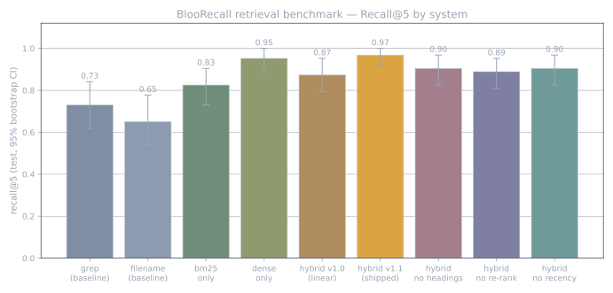

# BlooRecall

**Local, private "where did I write that?" search for your notes — built for coding agents.**

BlooRecall indexes your Markdown / text / reStructuredText and finds files by *meaning and
keyword*, not just filename. It blends BM25 lexical scoring with dense embeddings from a local
[Ollama](https://ollama.com) model, so a search for "how the gateway retries a dropped socket"
finds the note that says "exponential backoff on reconnect" even with no shared words.

It ships a CLI for you and an [MCP](https://modelcontextprotocol.io) server for your coding agent,
over one engine. Everything runs on your machine — no cloud, no API keys, nothing uploaded.

```
$ bloorecall search "how do we retry a dropped socket"
 1. 1.08  ~/notes/gateway/reconnect-design.md
    notes · 2026-08-12 · [OK] disk hash matches
    Reconnect design > Backoff: on disconnect the client waits with exponential backoff...
```

## Why

- **Finds notes by idea, not filename.** Great when you remember *what* you wrote, not *where*.
- **Local and private.** Embeddings come from Ollama on `127.0.0.1`; BlooRecall only reads your
  corpus (read-only) and only writes inside its own project dir.
- **Agent-native.** An MCP tool (`bloorecall_search`) lets an AI assistant look things up itself
  instead of making you paste context. Pairs well with code-structure tools like
  [sem](https://github.com/Ataraxy-Labs/sem): sem knows your *code*, BlooRecall knows your *notes*.
- **Trustworthy results.** Each hit is re-checked against the file on disk and flagged `[OK]` or
  `[DRIFT]`, so an agent never quotes a stale snippet as current.
- **Heading-aware.** Markdown chunks carry their heading trail (`Design > Phased build > P0`), so a
  paragraph matches queries whose words only live in the section titles.
- **Safe by default.** Credential-shaped queries are refused; `secrets`, `credentials`, `.env`,
  `memory` and `sessions` paths are skipped during indexing.

## Install

Requires Python 3.12+, `numpy`, the `mcp` SDK, and a running local Ollama with an embedding model.

```bash
git clone <this repo> && cd bloorecall
pip install numpy mcp
ollama pull qwen3-embedding:0.6b          # any Ollama embedding model works; set it in config
python3 -m unittest discover -s tests     # no network needed
```

Put `bin/` on your `PATH` for a short command, or run `./bin/bloorecall` in place.

## Quick start

```bash
bloorecall init --root ~/notes --root ~/projects   # write config.json for your folders
bloorecall refresh                                 # build the index (incremental after the first run)
bloorecall search "restic backup runbook"
bloorecall status                                  # index size, model, freshness
bloorecall doctor                                  # config / ollama / index / MCP checks
```

If Ollama is down, search still works in keyword-only mode and says so.

## Use it from a coding agent (MCP)

`bloorecall serve` (or `bin/bloorecall-mcp`) is an MCP stdio server exposing one tool,
`bloorecall_search(query, top_k=10, project=None)`. It returns ranked paths with snippets and a
trust note — never whole files.

**Claude Code / any client with `claude mcp`:**

```bash
claude mcp add bloorecall -- /abs/path/to/bloorecall/bin/bloorecall-mcp
```

**Any client with an `mcpServers` config:**

```json
{
  "mcpServers": {
    "bloorecall": { "command": "/abs/path/to/bloorecall/bin/bloorecall-mcp", "args": [] }
  }
}
```

`BLOORECALL_CONFIG=/path/to/config.json` selects a non-default config.

## How it works

1. **Index** (`bloorecall refresh`): walk your corpus roots, apply safety gates, chunk each file
   (heading-aware for Markdown), embed changed chunks via Ollama, store vectors + a BM25 index in
   SQLite. Incremental: an unchanged file is skipped by size/mtime, an edited paragraph re-embeds
   one chunk. A no-change refresh is ~instant.
2. **Search**: embed the query, rank every chunk by meaning (dense) and by keyword (BM25), and
   fuse the two orders with reciprocal-rank fusion, plus small recency and path-match bonuses (a
   named, editable policy; a path match is a query word naming the file or one of its folders
   under the corpus root). Fusing ranks rather than raw scores keeps either signal from drowning
   out the other. Keep the best chunk per file, re-rank the top results with a term-coverage
   bonus, then verify each hit against disk. If the embedder is down, or the index was built with
   a different model than the config names, search ranks by keyword alone and says why.

## Benchmark

Against a one-pass grep baseline (what an agent gets from a single `rg` search) on a 251-file
synthetic corpus, BlooRecall v1.1 reaches **Recall@5 0.97 vs grep's 0.73** (MRR@10 0.89 vs
0.58), and matches or beats grep in every query category.

v1.0 shipped a linear blend that, it turned out, let BM25 overrule the embeddings (0.87 / 0.77,
behind embeddings alone at 0.95 / 0.86). v1.1 fuses ranks instead: it sits level with
embeddings-only on meaning-style queries and keeps keyword search's edge on exact identifiers.
The fusion was picked on the dev split (`python3 -m bench.sweep`) and confirmed once on test;
the report has the diagnosis.

v1.2 fixes ranking bugs rather than retuning weights. The tokenizer kept a sentence's full stop
(`backoff.` never matched `backoff`; 7% of the corpus's tokens), and whole paths were one token,
so the path-match bonus almost never fired. Fusion also counted function words ("the", "a") as
keyword evidence, and gave a chunk with no keyword match nothing from BM25, ranking it below
every chunk that shared a word with the query. Short texts show it worst: on a
[probe of 40 haiku](bench/haiku/README.md) with queries that share no content word with their
poem, v1.1's fusion scored MRR@10 0.29 where embeddings alone scored 0.85. v1.2 drops function
words from the BM25 query and ranks unmatched chunks just after the last match: 0.69.

Measured on the same harness with a stand-in embedder (all-MiniLM-L6-v2; the work was done
without Ollama), v1.2 against v1.1 on the test split: shipped-policy Recall@5 0.936 → 0.984
(3 queries gained, none lost), MRR@10 flat (−0.010, 95% CI [−0.057, +0.040]), keyword-only
nDCG@10 +0.041 (CI [+0.001, +0.084]); the grep baseline is byte-identical. The qwen3 numbers here
and in the report are v1.1's; `python3 -m bench.run --system all --split test --fresh` then
`python3 -m bench.report` brings them up to date.



Synthetic corpus and queries, one 0.6B embedding model, 63 test queries: treat the gaps between
systems as the signal, not the absolute numbers. Setup, per-category results, an independent
red-team review and one-command reproduction are in [`bench/REPORT.md`](bench/REPORT.md).

## Configuration

`config.json` (write a starter with `bloorecall init`). Key fields: `corpus_roots` (read-only
folders with a `label` and `max_files`), `allowed_extensions`, `embedding` (Ollama model +
endpoint), `policies` / `active_policy` (retrieval weights and `fusion`: `rrf`, or `raw` for the
v1.0 blend), `exclusions`, `search_defaults`. All paths are absolute; the index lives under the
project's `var/`.

**Upgrading from v1.0:** a policy without a `fusion` key keeps the v1.0 blend, so a policy id
always means one behavior. To get v1.1's ranking, copy the `hybrid-rrf-v1` block from
`config.example.json` into your `policies` and set `"active_policy": "hybrid-rrf-v1"`.

**Upgrading to v1.2:** nothing to run. Search re-tokenizes an older index in memory, and the
next `bloorecall refresh` rewrites it on disk without re-embedding (its summary counts
`retokenized` chunks). Behavior changes:
- Ranking: the fixes in [Benchmark](#benchmark) apply to every policy, so `hybrid-rrf-v1` and
  `baseline-v0` rank a little differently than they did in v1.1.
- Results no longer carry `trust.embedding_fresh`. It read the embedding cache, whose entries
  expire after `vector_cache_days`, so every file left unedited for two weeks came back
  `weak`/`[DRIFT]`. Verdicts now depend on the file alone.
- `refresh` drops the files of a root you remove from the config. A root that is only missing
  on disk (an unmounted drive) still keeps its files until it comes back.
- Keyword-only search (embedder down) returns only files that share a word with the query,
  instead of padding the list by recency.
- Shallow `verify` compares each file's size and mtime with the index (it used to check only
  that files exist), and files that refresh refuses on content (secret-shaped, not UTF-8,
  blank) no longer count as unindexed drift.
- `refresh` re-chunks every file on its own when `chunk_chars`, `chunk_overlap_chars` or
  `parse_version` change (they used to need `--full`), logs every file it skips with a reason in
  `rejections.jsonl` next to the index, warns when a root holds more files than its `max_files`,
  refuses to run twice at once on one index, and keeps the index files owner-only (mode 600).
- Config: `chunk_chars` and `chunk_overlap_chars` are required (refresh failed without them
  anyway), the overlap must be shorter than the chunk, and `corpus_roots` may not be empty.
- A query holding a pasted key or token is refused like a credential-phrased one, and
  `search --json` prints a refusal as JSON.

## Keeping it fresh

`bloorecall refresh` is incremental and idempotent: an edit re-embeds only the chunks whose text
changed, however long the file sat untouched. `scripts/bloorecall-refresh.sh` is a cron-ready
wrapper (its header has a sample crontab line). `bloorecall verify` runs a read-only drift audit
against size and mtime, `--deep` re-hashes every file (exit 1 on drift);
`bloorecall doctor --verify-drift` adds the deep audit to the health check.

## Status

v1.2. Tests run locally, no network or Ollama needed. Born as a throwaway tool for personal
knowledge-base research that turned out to be genuinely useful, so it's shared in case it helps
you too.

## License

MIT — see [LICENSE](LICENSE).
