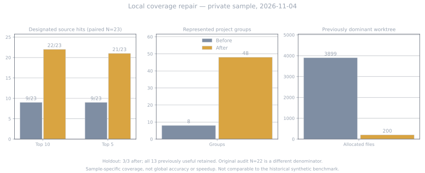

# Opt-in corpus allocation repair — 2026-11-04

## Behavior and safe configuration

Roots default to `newest` selection (unchanged). For a broad projects root,
set `"selection": "balanced"`, `"max_files": 4000` and
`"max_files_per_project": 200`. The last value defaults to 200 and must
be positive. Root caps and max_depth must be nonnegative integers; zero means
unlimited. Balanced selection still applies its per-project quota with no root cap.

Buckets are the first directory below the root, plus a bucket for root-level files.
They are traversed in sorted round-robin order. Within each bucket shallow
README/AGENTS/STATE and handoff/next-push Markdown locators come first, then shallow
docs/specs, then newest mtime with path tie-breaking. Locators consume quota;
there is no reserved slot outside the caps. If the root cap is smaller than the
bucket count, not every bucket is guaranteed a slot. Many first-level worktrees
can collectively consume many slots; this is not repository-identity deduplication.

For missing operational coverage, add only a reviewed single-file root or a bounded
docs subtree, not a whole shared/private directory. Explicit roots do not bypass
path, hidden-subtree, symlink-ancestor, size, extension, or content-secret gates.
The existing .openclaw infrastructure ancestor is allowed, but hidden paths below
a configured directory root are not. Denied path segments always win. Root overlap
is owned by the first root that actually selects a canonical file, not one that
merely discovers and discards it. Selection occurs before content validation;
blocked content is not backfilled, so quotas are upper bounds, not target counts.

Exclude evaluation reports, query ledgers, generated artifacts, backups and indexes
with `exclusions.denied_globs` before refreshing: otherwise search can return
its own evaluation write-up rather than source evidence. Review the resulting
manifest and rejection log. Back up the existing index/config before refreshing;
restore them together to roll back. No model, ranking, chunker or dependency change
is required by this repair. Configs with unknown selection or invalid quotas now fail
validation rather than silently selecting an unintended corpus.

## Anonymized local evidence (not the synthetic benchmark)

Source: `bench/coverage-20261104.json`, aggregate measurements from one private
local deployment. Raw queries, sources, paths, indexes, logs and transcripts are
intentionally not published. The private experiment cannot be fully reproduced
from this public aggregate; unit tests reproduce allocation and safety mechanics.

| Measure | Before | After |
|---|---:|---:|
| Paired known-source designated hit in top 10 (N=23) | 9/23 | 22/23 |
| Paired known-source designated hit in top 5 (N=23) | 9/23 | 21/23 |
| Represented project groups | 8 | 48 |
| Files allocated to the previously dominant worktree | 3899 | 200 |

Three fresh holdout questions, frozen before their first query: 3/3 after repair.
All 13 previously useful cases were retained. One designated known source remained
outside top 10 even though indexed: coverage does not eliminate ranking misses.

Original audit N=22 is different from paired N=23: one previously lost harness
response was recovered. Do not compare 9/22 directly with 22/23. One additional
question has unknown truth and is excluded from both known-source denominators.
The paired sample reused the same source snapshot. Activation was checked through
the actual MCP consumer, not only an offline harness.

This is **sample-specific coverage gain**, not global accuracy or a ranking/model
improvement. The intervention combines allocation, narrow explicit coverage and
removal of self-indexed evaluation artifacts; it does not isolate their individual
contributions. Full-source independent relevance review remains incomplete; source
anchors were checked by the primary evaluator. No speedup is claimed.

The historical charts in `docs/benchmark*.svg` and data in
`bench/results/` describe a separate synthetic corpus and frozen test split.
Their values are preserved, not replaced or pooled with this private sample.
Neither chart is evidence of a new synthetic benchmark run after this repair.

## Upstream reconciliation and test status

The operational repair was developed in a dirty local worktree. Publication ports
only the isolated corpus/config/indexer repair, targeted synthetic tests and these
sanitized aggregates into a fresh upstream clone. No local config or other dirty
code is published, and no dependency changes are needed.

That local worktree had six pre-existing trust/drift failures (five stale
`cached_text_hashes` API errors and one shallow silent-rewrite expectation).
They reproduced on its untouched pre-repair backup. They are not new repair
failures and were not silently fixed by this publication. Clean upstream baseline
commit `14146b5` instead passes all 112 tests, including its trust/drift tests:
upstream already differs from that dirty worktree. The publication tree is tested
separately; a green upstream result must not be described as repairing those six
local failures. Historical results remain historical.
